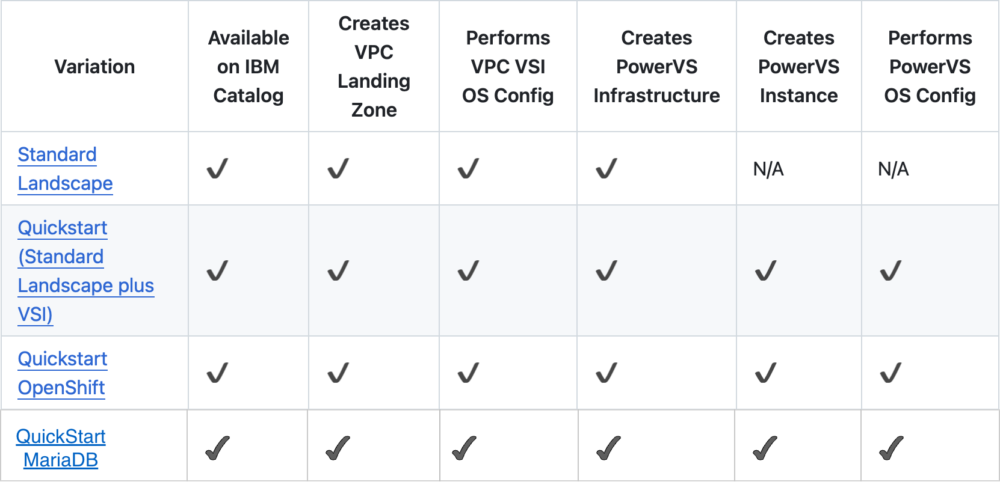

---

copyright:
  years: 2023, 2026
lastupdated: "2026-11-04"
keywords: powervs, landing zone, sap, automation, deployable architecture
subcollection: powervs-vpc

---

{{site.data.keyword.attribute-definition-list}}

# Overview of {{site.data.keyword.powerSys_notm}} with VPC landing zone deployable architectures
{: #automation-solution-overview}

Provisioning {{site.data.keyword.powerSys_notm}} with VPC landing zone by using deployable architectures provides an automated deployment method to create an isolated {{site.data.keyword.powerSys_notm}} workspace and connect it with IBM Cloud services and public internet. Network management components like DNS, NTP, proxy servers and NFS as a Service might be installed. Additionally, {{site.data.keyword.monitoringfull_notm}} and {{site.data.keyword.sysdigsecure_full_notm}} can be selected as optional features. Comparing the provisioning through the projects UI, user interaction is minimized and ready-to-go deployment time of a {{site.data.keyword.powerSys_notm}} workspace is reduced from days to less than 1 hour.

Automated {{site.data.keyword.powerSys_notm}} with VPC landing zone provisioning that is described in this guide is based on {{site.data.keyword.cloud_notm}} catalog deployable architectures. In this documentation, we describe only specifics that are related to {{site.data.keyword.powerSys_notm}} with VPC landing zone deployable architecture.

In the following sections, the deployable architecture variants are described.

{: caption="Solution Overview" caption-side="center"}

## 1. Standard Landscape variation
{: #overview-standard-variant}

This deployable architecture variation deploys these resources:

| Resource Type | Optional | Description |
|---|---|---|
| Workspace for {{site.data.keyword.powerSys_notm}} |  | [Workspace for {{site.data.keyword.powerSys_notm}}](/docs/power-iaas?topic=power-iaas-creating-power-virtual-server#creating-service) with 2 subnets and an SSH key |
| Custom Images | Yes | Imports up to three custom images from Cloud Object Storage into Workspace for {{site.data.keyword.powerSys_notm}} |
{: class="standard-variant-table"}
{: tab-group="standard-variant"}
{: #standard-variant-1}
{: tab-title="{{site.data.keyword.powerSys_notm}}"}
{: caption="Standard Landscape variation Components" caption-side="bottom"}

| Resource Type | Optional | Description |
|---|---|---|
|  VPC |  |  Edge VPC: ACL, SGs, SSH Key and 4 Subnets |
|  Intel VSI |  | Jump box with 2 cores, 4GB memory running RHEL 9.6 with floating IP attached |
|  Intel VSI |  | Network Services running RHEL 9.6 configured as squid proxy, NTP and DNS servers(using Ansible Galaxy collection roles [IBM Power Linux for SAP](https://galaxy.ansible.com/ui/repo/published/ibm/power_linux_sap/)). Also configured as central ansible execution node. Default size is 2 cores and 4 GB memory. Can be customized. |
| File storage share,\n Network load balancer | Yes | [NFS as a Service](/docs/vpc?topic=vpc-file-storage-create&interface=ui)\n [Network Load Balancer](/docs/vpc?group=network-load-balancer) is deployed along with File storage share to access the share IP from Power Virtual Server |
| Virtual Private Endpoint Gateway|  | A [Virtual Private Endpoint Gateway](/docs/vpc?topic=vpc-about-vpe) to reach the Cloud Object Storage bucket |
| Flow Logs for VPC| Yes | [Flow Logs for VPC](/docs/vpc?topic=vpc-flow-logs) enables the collection, storage, and presentation of information about the Internet Protocol (IP) traffic going to and from network interfaces within your VPC|
| Client to site VPN Server,\nSecrets Manager | Yes | [Client to site VPN Server](/docs/vpc?topic=vpc-vpn-client-to-site-overview) provides client-to-site connectivity, which allows remote devices to securely connect to the VPC network using an OpenVPN software client.\n [Secrets Manager](/docs/secrets-manager) Instance is deployed along with VPN to store the VPN Certificate |
{: class="standard-variant-table"}
{: tab-group="standard-variant"}
{: #standard-variant-2}
{: tab-title="VPC"}
{: caption="Standard Landscape variation Components" caption-side="bottom"}

| Resource Type | Optional | Description |
|---|---|---|
| Key Protect |  | [Key Protect](/docs/key-protect) provides key management by integrating the IBM Key Protect for IBM Cloud service. These key management services help you create, manage, and use encryption keys to protect your sensitive data |
| Transit Gateway |  | Global or local [Transit Gateway](/docs/transit-gateway) to interconnect VPC and {{site.data.keyword.powerSys_notm}} workspace |
| Cloud Object Storage | |  [Cloud Object Storage](/docs/cloud-object-storage) instance, buckets and credentials are created |
| {{site.data.keyword.monitoringfull_notm}} | Yes | [{{site.data.keyword.monitoringshort}}](/docs/monitoring?topic=monitoring-about-monitor) collects metrics to provide a web UI to monitor the performance and overall system health of the deployment. Interconnects with {{site.data.keyword.sysdigsecure_full_notm}} if used. |
| {{site.data.keyword.sysdigsecure_full_notm}} | Yes | [{{site.data.keyword.sysdigsecure_short}}](/docs/workload-protection?topic=workload-protection-key-features#feature_1) can be used to find and prioritize software vulnerabilities, detect and respond to threats, manage configurations, permissions, and compliance from source to run. Interconnects with {{site.data.keyword.monitoringshort}} if used. |
{: class="standard-variant-table"}
{: tab-group="standard-variant"}
{: #standard-variant-3}
{: tab-title="Cloud Service"}
{: caption="Standard Landscape variation Components" caption-side="bottom"}

## 2. Quickstart variation
{: #overview-quickstart-variant}

This deployable architecture variation deploys these resources:

| Resource Type | Optional | Description |
|---|---|---|
| Workspace for {{site.data.keyword.powerSys_notm}} |  | [Workspace for {{site.data.keyword.powerSys_notm}}](/docs/power-iaas?topic=power-iaas-creating-power-virtual-server#creating-service) with 2 subnets and an SSH key |
| {{site.data.keyword.powerSys_notm}} Instance  |  | A {{site.data.keyword.powerSys_notm}} instance of chosen T-shirt size or a custom t-shirt size. Refer to the [table](/docs/powervs-vpc?topic=powervs-vpc-automation-solution-overview#resize_core_memory-1) below. |
{: class="quickstart-variant-table"}
{: tab-group="quickstart-variant"}
{: #quickstart-variant-1}
{: tab-title="{{site.data.keyword.powerSys_notm}}"}
{: caption="Quickstart Variation Components" caption-side="bottom"}

| Resource Type | Optional | Description |
|---|---|---|
|  VPC |  |  Edge VPC: ACL, SGs, SSH Key and 4 Subnets |
|  Intel VSI |  | Jump box running RHEL 9.6 with floating IP attached |
|  Intel VSI |  | Network Services running RHEL 9.6 configured as squid proxy, NTP and DNS servers(using Ansible Galaxy collection roles [IBM Power Linux for SAP](https://galaxy.ansible.com/ui/repo/published/ibm/power_linux_sap/)). Also configured as central ansible execution node |
| File storage share,\n Network load balancer | Yes | [NFS as a Service](/docs/vpc?topic=vpc-file-storage-create&interface=ui)\n [Network Load Balancer](/docs/vpc?group=network-load-balancer) is deployed along with File storage share to access the share IP from Power Virtual Server |
| Virtual Private Endpoint Gateway|  | A [Virtual Private Endpoint Gateway](/docs/vpc?topic=vpc-about-vpe) to reach the Cloud Object Storage bucket |
| Flow Logs for VPC| Yes | [Flow Logs for VPC](/docs/vpc?topic=vpc-flow-logs) enables the collection, storage, and presentation of information about the Internet Protocol (IP) traffic going to and from network interfaces within your VPC|
| Client to site VPN Server,\nSecrets Manager | Yes | [Client to site VPN Server](/docs/vpc?topic=vpc-vpn-client-to-site-overview) provides client-to-site connectivity, which allows remote devices to securely connect to the VPC network using an OpenVPN software client.\n [Secrets Manager](/docs/secrets-manager) Instance is deployed along with VPN to store the VPN Certificate |
{: class="quickstart-variant-table"}
{: tab-group="quickstart-variant"}
{: #quickstart-variant-2}
{: tab-title="VPC"}
{: caption="Quickstart Variation Components" caption-side="bottom"}

| Resource Type | Optional | Description |
|---|---|---|
| Key Protect |  | [Key Protect](/docs/key-protect) provides key management by integrating the IBM Key Protect for IBM Cloud service. These key management services help you create, manage, and use encryption keys to protect your sensitive data |
| Transit Gateway |  | Global or local [Transit Gateway](/docs/transit-gateway) to interconnect VPC and {{site.data.keyword.powerSys_notm}} workspace |
| Cloud Object Storage | |  [Cloud Object Storage](/docs/cloud-object-storage) instance, buckets and credentials are created |
| {{site.data.keyword.monitoringfull_notm}} | Yes | [{{site.data.keyword.monitoringshort}}](/docs/monitoring?topic=monitoring-about-monitor) collects metrics to provide a web UI to monitor the performance and overall system health of the deployment. Interconnects with {{site.data.keyword.sysdigsecure_full_notm}} if used. |
| {{site.data.keyword.sysdigsecure_full_notm}} | Yes | [{{site.data.keyword.sysdigsecure_short}}](/docs/workload-protection?topic=workload-protection-key-features#feature_1) can be used to find and prioritize software vulnerabilities, detect and respond to threats, manage configurations, permissions, and compliance from source to run. Interconnects with {{site.data.keyword.monitoringshort}} if used. |
{: class="quickstart-variant-table"}
{: tab-group="quickstart-variant"}
{: #quickstart-variant-3}
{: tab-title="Cloud Service"}
{: caption="Quickstart Variation Components" caption-side="bottom"}

You can run AIX, IBM i, and Linux images on your virtual server instances. Select the required T-shirt size and a virtual server instance with chosen T-shirt size or custom configuration is deployed. The T-shirt sizes and the configuration parameters mapping are shown in the following table:

|  | XS | S | M | L |
|---------------------- | ------------------------- | ------------------------- | -------------------------  | ------------------------- |
| Cores | 1 | 4 | 8 | 15 |
| Memory | 32 | 128 | 256 | 512 |
| Boot Storage Tier-3 (GB) | 30 | 30 | 30 | 30 |
| Data Storage Tier-3 (GB) | 100 | 500 | 1000 | 2000 |
{: class="simple-tab-table"}
{: tab-group="t-shirt size"}
{: caption="T-shirt size and configuration mapping" caption-side="top"}
{: #resize_core_memory-1}
{: tab-title="AIX"}

|  | XS | S | M | L |
|---------------------- | ------------------------- | ------------------------- | -------------------------  | ------------------------- |
| Cores | 0.25 | 1 | 2 | 4 |
| Memory | 8 | 32 | 64 | 132 |
| Data Storage Tier-3 (GB) | 100 | 500 | 1000 | 2000 |
{: class="simple-tab-table"}
{: tab-group="t-shirt size"}
{: caption="T-shirt size and configuration mapping" caption-side="top"}
{: #resize_core_memory-2}
{: tab-title="IBM i"}

|  | US1 \n Test/Dev |
|---------------------- | ------------------------- |
| Cores | 4 |
| Memory | 256 |
| Data Storage Tier-3 (GB) | 750 |
{: class="simple-tab-table"}
{: tab-group="t-shirt size"}
{: caption="T-shirt size and configuration mapping" caption-side="top"}
{: #resize_core_memory-3}
{: tab-title="SAP HANA (RHEL/SLES)"}

## 3. Quickstart OpenShift variation
{: #overview-standard-openshift-variant}

The 'OpenShift {{site.data.keyword.powerSys_notm}} with VPC landing zone' variation creates a landing zone similar to that in the Standard Landscape variation and leverages its features to create an OpenShift cluster on {{site.data.keyword.powerSys_notm}}.

This deployable architecture variation deploys these resources:

| Resource Type | Optional | Description |
|---|---|---|
| Workspace for {{site.data.keyword.powerSys_notm}} |  | [Workspace for {{site.data.keyword.powerSys_notm}}](/docs/power-iaas?topic=power-iaas-creating-power-virtual-server#creating-service) with a DHCP subnet and an SSH key |
| {{site.data.keyword.powerSys_notm}} Instances |  | 1 or 3 {{site.data.keyword.powerSys_notm}} instances as OpenShift master nodes\n 2 or more {{site.data.keyword.powerSys_notm}} instances as OpenShift worker nodes\n Custom profile (cores, memory, machine type, core type) |
{: class="standard-openshift-variant-table"}
{: tab-group="standard-openshift-variant"}
{: #standard-openshift-variant-1}
{: tab-title="{{site.data.keyword.powerSys_notm}}"}
{: caption="Quickstart OpenShift variation Components" caption-side="bottom"}

| Resource Type | Optional | Description |
|---|---|---|
|  VPC |  |  Edge VPC: ACL, SGs, SSH Key and 4 Subnets |
|  Intel VSI |  | Jump box with 2 cores, 4GB memory running RHEL 9.6 with floating IP attached |
|  Intel VSI |  | Network Services running RHEL 9.6 configured as squid proxy (using Ansible Galaxy collection roles [IBM Power Linux for SAP](https://galaxy.ansible.com/ui/repo/published/ibm/power_linux_sap/)) and configured as central ansible execution node. Default size is 2 cores and 4 GB memory. Can be customized. |
| Flow Logs for VPC| Yes | [Flow Logs for VPC](/docs/vpc?topic=vpc-flow-logs) enables the collection, storage, and presentation of information about the Internet Protocol (IP) traffic going to and from network interfaces within your VPC|
| Client to site VPN Server,\nSecrets Manager | Yes | [Client to site VPN Server](/docs/vpc?topic=vpc-vpn-client-to-site-overview) provides client-to-site connectivity, which allows remote devices to securely connect to the VPC network using an OpenVPN software client.\n [Secrets Manager](/docs/secrets-manager) Instance is deployed along with VPN to store the VPN Certificate |
| Three Application Load Balancers | | One for internal OpenShift API, public OpenShift API, and OpenShift applications |
{: class="standard-openshift-variant-table"}
{: tab-group="standard-openshift-variant"}
{: #standard-openshift-variant-2}
{: tab-title="VPC"}
{: caption="Quickstart OpenShift variation Components" caption-side="bottom"}

| Resource Type | Optional | Description |
|---|---|---|
| Key Protect |  | [Key Protect](/docs/key-protect) provides key management by integrating the IBM Key Protect for IBM Cloud service. These key management services help you create, manage, and use encryption keys to protect your sensitive data |
| Transit Gateway |  | Global or local [Transit Gateway](/docs/transit-gateway) to interconnect VPC and {{site.data.keyword.powerSys_notm}} workspace |
| Cloud Object Storage | |  [Cloud Object Storage](/docs/cloud-object-storage) instance, buckets and credentials are created |
| {{site.data.keyword.monitoringfull_notm}} | Yes | [{{site.data.keyword.monitoringshort}}](/docs/monitoring?topic=monitoring-about-monitor) collects metrics to provide a web UI to monitor the performance and overall system health of the deployment. Interconnects with {{site.data.keyword.sysdigsecure_full_notm}} if used. |
| {{site.data.keyword.sysdigsecure_full_notm}} | Yes | [{{site.data.keyword.sysdigsecure_short}}](/docs/workload-protection?topic=workload-protection-key-features#feature_1) can be used to find and prioritize software vulnerabilities, detect and respond to threats, manage configurations, permissions, and compliance from source to run. Interconnects with {{site.data.keyword.monitoringshort}} if used. |
| {{site.data.keyword.dns_full_notm}} | | A DNS service instance is created for internal resolution of the cluster domain. |
{: class="standard-openshift-variant-table"}
{: tab-group="standard-openshift-variant"}
{: #standard-openshift-variant-3}
{: tab-title="Cloud Service"}
{: caption="Quickstart OpenShift variation Components" caption-side="bottom"}

## 4. Quickstart MariaDB variation
{: #overview-quickstart-mariadb-variant}

The Quickstart MariaDB variation creates a landing zone similar to that in the Quickstart variation. It also deploys a RHEL {{site.data.keyword.powerSys_notm}} instance with MariaDB installed and configured by Ansible. The InnoDB buffer pool is auto-tuned to the memory of the instance, and the data is stored on a dedicated XFS volume that is mounted on `/var/lib/mysql`.

This deployable architecture variation deploys these resources:

| Resource Type | Optional | Description |
|---|---|---|
| Workspace for {{site.data.keyword.powerSys_notm}} |  | [Workspace for {{site.data.keyword.powerSys_notm}}](/docs/power-iaas?topic=power-iaas-creating-power-virtual-server#creating-service) with a management network, a backup network, and an SSH key |
| {{site.data.keyword.powerSys_notm}} Instance |  | A RHEL {{site.data.keyword.powerSys_notm}} instance of chosen T-shirt size (`mariadb_xs`, `mariadb_s`, `mariadb_m`, `mariadb_l`) or a custom profile. MariaDB (default version 12.3) is installed and configured automatically. One data volume is mounted on `/var/lib/mysql` (XFS). Refer to the [table](/docs/powervs-vpc?topic=powervs-vpc-automation-solution-overview#mariadb-tshirt-sizes) below. |
| MariaDB replicas | Yes | If `mariadb_replica_count` is greater than 0, that many replica {{site.data.keyword.powerSys_notm}} instances are deployed with the same sizing as the primary. They replicate from the primary instance. |
| MariaDB sample data | Yes | Loads the `sakila`, `world`, or `vector` sample dataset after installation. |
{: class="quickstart-mariadb-variant-table"}
{: tab-group="quickstart-mariadb-variant"}
{: #quickstart-mariadb-variant-1}
{: tab-title="{{site.data.keyword.powerSys_notm}}"}
{: caption="Quickstart MariaDB variation Components" caption-side="bottom"}

| Resource Type | Optional | Description |
|---|---|---|
|  VPC |  |  Edge VPC: ACL, SGs, SSH Key and 4 Subnets |
|  Intel VSI |  | Jump box running RHEL 9.6 with floating IP attached |
|  Intel VSI |  | Network Services running RHEL 9.6 configured as squid proxy, NTP and DNS servers (using Ansible Galaxy collection roles [IBM Power Linux for SAP](https://galaxy.ansible.com/ui/repo/published/ibm/power_linux_sap/)). Also configured as central ansible execution node that installs MariaDB. Default size is 2 cores and 4 GB memory. Can be customized. |
| File storage share,\n Network load balancer | Yes | Disabled by default because the MariaDB data is stored on a dedicated volume. When enabled, [NFS as a Service](/docs/vpc?topic=vpc-file-storage-create&interface=ui) and [Network Load Balancer](/docs/vpc?group=network-load-balancer) are deployed to access the share IP from Power Virtual Server |
| Virtual Private Endpoint Gateway|  | A [Virtual Private Endpoint Gateway](/docs/vpc?topic=vpc-about-vpe) to reach the Cloud Object Storage bucket |
| Flow Logs for VPC| Yes | [Flow Logs for VPC](/docs/vpc?topic=vpc-flow-logs) enables the collection, storage, and presentation of information about the Internet Protocol (IP) traffic going to and from network interfaces within your VPC|
| Client to site VPN Server,\nSecrets Manager | Yes | [Client to site VPN Server](/docs/vpc?topic=vpc-vpn-client-to-site-overview) provides client-to-site connectivity, which allows remote devices to securely connect to the VPC network using an OpenVPN software client.\n [Secrets Manager](/docs/secrets-manager) Instance is deployed along with VPN to store the VPN Certificate |
{: class="quickstart-mariadb-variant-table"}
{: tab-group="quickstart-mariadb-variant"}
{: #quickstart-mariadb-variant-2}
{: tab-title="VPC"}
{: caption="Quickstart MariaDB variation Components" caption-side="bottom"}

| Resource Type | Optional | Description |
|---|---|---|
| Key Protect |  | [Key Protect](/docs/key-protect) provides key management by integrating the IBM Key Protect for IBM Cloud service. These key management services help you create, manage, and use encryption keys to protect your sensitive data |
| Transit Gateway |  | Global or local [Transit Gateway](/docs/transit-gateway) to interconnect VPC and {{site.data.keyword.powerSys_notm}} workspace |
| Cloud Object Storage | |  [Cloud Object Storage](/docs/cloud-object-storage) instance, buckets and credentials are created |
| Activity Tracker | Yes | Activity Tracker resources (KMS key, Cloud Object Storage instance, bucket, and configuration) are created to keep an audit trail of the activities in the account. Enabled by default. |
| {{site.data.keyword.sysdigsecure_full_notm}} | Yes | [{{site.data.keyword.sysdigsecure_short}}](/docs/workload-protection?topic=workload-protection-key-features#feature_1) can be used to find and prioritize software vulnerabilities, detect and respond to threats, manage configurations, permissions, and compliance from source to run. The agent is configured on the Intel VSIs and on the MariaDB instances. |
{: class="quickstart-mariadb-variant-table"}
{: tab-group="quickstart-mariadb-variant"}
{: #quickstart-mariadb-variant-3}
{: tab-title="Cloud Service"}
{: caption="Quickstart MariaDB variation Components" caption-side="bottom"}

Select the required T-shirt size and a {{site.data.keyword.powerSys_notm}} instance with the chosen T-shirt size or custom configuration is deployed with MariaDB installed. The T-shirt sizes and the configuration parameters mapping are shown in the following table:

|  | XS | S | M | L |
|---------------------- | ------------------------- | ------------------------- | -------------------------  | ------------------------- |
| Preset name | `mariadb_xs` | `mariadb_s` | `mariadb_m` | `mariadb_l` |
| Cores | 0.25 | 1 | 2 | 4 |
| Memory | 4 | 8 | 16 | 32 |
| Data Storage Tier-3 (GB) | 50 | 100 | 250 | 500 |
{: class="simple-tab-table"}
{: caption="MariaDB T-shirt size and configuration mapping" caption-side="top"}
{: #mariadb-tshirt-sizes}

The default size is `mariadb_s`. To use a custom profile, set `tshirt_size` to `custom` and also set `custom_profile_instance_boot_image`. For all MariaDB-specific inputs, see [Quickstart MariaDB parameters](/docs/powervs-vpc?topic=powervs-vpc-powervs-automation-mariadb-prereqs).

## Other {{site.data.keyword.powerSys_notm}} related deployable architectures
{: #overview-automation-solution-components}

In addition to the {{site.data.keyword.powerSys_notm}} with VPC landing zone other deployable architectures and terraform based solutions might be deployed.

- [{{site.data.keyword.powerSys_notm}} for SAP HANA deployable architecture](/docs/sap-powervs)
- [FalconStor StorSafe VTL for {{site.data.keyword.powerSys_notm}} Cloud](https://falconstor-download.s3.us-east.cloud-object-storage.appdomain.cloud/FalconStor%20VTL%20for%20IBM%20Deployment%20Guide.pdf){: external}
